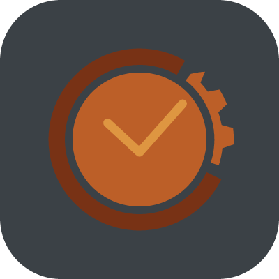

<div align="center">



# Rusty Watch

**Native watchface editor for Amazfit Active 2 (Round) · Zepp OS 4.x**

Design watchfaces for the **Amazfit Active 2 (Round)** on Windows 11, check the result
in a **1:1 preview (466 × 466)** and export a ready-to-install **`.zip`** package.

[](https://www.rust-lang.org/)
[](https://dotnet.microsoft.com/)
[](https://learn.microsoft.com/windows/apps/)
[](https://docs.zepp.com/)
[](https://www.microsoft.com/windows)
[](LICENSE)

**[🇵🇱 Read in Polish / Czytaj po polsku](README.pl.md)**

<a href="docs/TECHNICAL.md">🔧 Technical deep-dive</a> ·
<a href="docs/FORMAT.md">Project format</a> ·
<a href="PLAN.md">Plan</a> ·
<a href="AGENTS.md">For AI agents</a> ·
<a href="Readme.base">Base documentation</a>

</div>

---

## 📖 Overview

### 🎯 What is Rusty Watch?

Rusty Watch is a **dedicated watchface editor** for the **Amazfit Active 2 (Round)**
(466 × 466 px, Zepp OS 4.x, `deviceSource: 8913153`). Instead of hand-writing
`app.json` and JavaScript for ZeppOS, you build a watchface in a native Windows UI,
arrange layers, attach assets and export an installable package with one click.

The project is an independent implementation inspired by the
[SashaCX75 editor](https://github.com/SashaCX75/Watch-face-editor-for-Amazfit-watch-on-ZeppOS) —
no code or assets from that project were copied.

### ✨ Key features

| Feature | Description |
| --- | --- |
| 🖥️ **1:1 preview** | Round 466 × 466 watchface with the fixed fully black background and every widget in export order. |
| 🧱 **Layers** | Panel to hide, reorder and remove widgets. The background is always the same full-black fill and has no layer. |
| 🖱️ **Frames & snapping** | Drag and resize widgets, 16 px grid, alignment guides to edges and centres, per-widget opacity (0–255). |
| 🕐 **Clocks** | Digital (custom format pattern) and analog (rotating PNG hand sets). |
| 📅 **Date & time data** | Date with an editable pattern, weekday number, week of year, day of year, lunar date, festivals, world clock. |
| ❤️ **Health & activity** | Steps, distance, heart rate, stress, PAI, skin temperature, sleep, calories and SpO₂. |
| 🎯 **Goals** | Step, calorie, stand and fat-burning targets from the sensor's `.target` field, with a unit checkbox. |
| 🖼️ **Assets** | TTF fonts, Image-widget graphics, hand sets, status icons and weather icons — shared stores across projects. |
| 🌐 **Watch language** | The exported ZIP detects the watch language itself (`pl-PL` → Polish month names and AM/PM). |
| 📦 **`.zip` export** | Self-contained package: generated JS plus every asset actually used. |
| 🧪 **Simulator test** | Installs the export in the official Zepp OS Simulator at the click of a button. |
| 🎛️ **Preview options** | Predefined mock data by default; **Live preview** switches only time/date to the real system clock. Custom values are editor-only and never affect the exported `.zip`. |

### 🧩 Available widgets

- **Time** — Digital time, Analog time
- **Date** — Date, Day of week (number), Week of year, Day of year, Lunar date, Festival, World clock
- **Text** — Text (user defined)
- **Image** — Image (blue frame fits the picture's natural size and only moves it; double-click turns it red and stretches the PNG while resizing)
- **Distance** — Step counter, Distance
- **Goals** — Step target, Calorie target, Stand target, Fat burning target
- **Health** — Heart rate (current, last valid, min/max/avg from `HEART.today`), Stress, PAI (today, last 7 days, weekly), Skin temperature, Calories, SpO₂ (current, hourly average), Stand hours, Fat burning
- **Sleep** — Sleep duration, Sleep score, Deep/Light/REM sleep, Time awake (minutes or %), Sleep start/end, Sleep target
- **Weather** — condition name, city, **current temperature from the watch firmware** (alignment/font/size/colour editable, value is not), high/low, sunrise/sunset, **time to sunrise/sunset** and 29 weather icons (Classic). Forecast-backed fields have a **forecast day** setting: Today / Tomorrow / Day after tomorrow / +3 / +4; missing days show `--`.

Add a widget with **+ Add widget** on the preview bar; the left-hand Widgets tab is a
read-only catalog of supported types. Weekday numbering defaults to **Monday = 1**
(Tuesday = 2); the Sunday-first variant is an App Settings option.

Goals read the watch sensor's `.target` field. **Stand target** and **Fat burning target**
may not be exposed on Amazfit Active 2 — if a sensor is missing, the watchface keeps the
project's default value; the editor shows a warning in the widget card and inspector.
The calorie, stand and fat-burning goals have a **Show unit** checkbox (`kcal`, `h`, `min`).

### 🎨 Asset management

| Store (`%APPDATA%\RustyWatch\…`) | Contents |
| --- | --- |
| `Fonts` | TTF fonts; bundled **Inter** (SIL OFL 1.1) by default. The preview uses the exact TTF exported to the watch. |
| `Images` | Graphics for the **Image** widget. |
| `Hands` | Analog hand sets (bundled **Classic** and **Light**). |
| `Weather` | Weather icon packs — bundled **Classic** (29 icons from OFL SVG masters, rendered at 512×512 PNG); you can add your own. |
| `Localization` | UI language catalogs — add your own without rebuilding the app. |

Selected assets are copied into the project folder, so **Save as…** and ZIP export
never depend on the application store. Hand textures are cropped to a tight alpha bounding box with an 8 px margin and
resampled in premultiplied-alpha space (no white edges), because ZeppOS cannot scale an `IMG` resource at runtime.

### 📤 Export and simulator

Clicking **Export** first renders a branded `preview.png` — the 21:37:40 watchface scaled into the `gear-outlayer.png` logo frame with black safe areas and a subtle dark outline — and an
8-frame animated, **infinitely looping** `preview.gif` (~1.7 s per frame; frame 1 is the composed `preview.png`, followed by the 7 raw frames). A small
progress bar on the Export button counts `1/8 … 8/8` and keeps animating while the
GIF is encoded; the dialog opens **only after** the GIF is ready and shows it **cropped
to the round watchface** above the watchface details and the **Export ZIP** button. Both
files are saved next to `project.json` and are **not** included in the `.zip`.

The previews are rendered entirely in Rust (`crates/rusty-core/src/preview.rs`) — never
with offscreen WinUI controls, which previously left a watchface-image artifact under
the editor. The 7 frames use hardcoded presets (7 real dates 2022-01-03 … 2022-07-31, weekdays Monday…Sunday, months January…July; strictly increasing time
seconds, forced HR extremes `56`/`120`); the seven dates are hardcoded (one per frame),
so month/day widgets visibly change. All date widgets in a frame share that single
date; steps are derived from distance (`1300`–`1400` steps/km), so `12.3 km` shows about
`16 000` steps. Battery decreases deterministically `100% → 10%`. Everything outside
the 233 px radius is opaque black in both formats. Custom preview data is ignored by
the generated files.

Export writes a `.zip` straight into the project folder — no save picker and no extra
steps. You can test it in the official
[Zepp OS Simulator](https://docs.zepp.com/docs/guides/tools/simulator/download/)
with **Test in emulator**: Rust exports to `%APPDATA%\RustyWatch\Emulator\app-<appId>`,
unpacks the package and installs it with
`zeus install --target "Amazfit Active 2 NFC (Round)"`.

> The simulator is Zepp Health software under its own licence. The app **does not bundle,
> copy or silently install it** — it only opens the official download page. Simulator
> testing validates the JS build/runtime but does not replace a real-device check.

Only the **`.zip`** format is exported (never `.zpk`).

### 🖥️ System category: battery and STATUS icons

The **System** catalog category contains **Battery** (from the `BATTERY` sensor, centred on
the watchface by default) and four status icons: **DND**, **LOCK**, **BLUETOOTH** and **ALARM** —
all directly in System, with no subcategory. New status icons form one centred horizontal row.
They use `hmUI.widget.IMG_STATUS` — ZeppOS shows or hides each icon itself, so no extra sensors
or timers are generated. Icon packs are read dynamically from `%APPDATA%\RustyWatch\Status\<pack>\`;
a valid pack must contain **all four** square PNGs: `alarm.png`, `dnd.png`, `bluetooth.png`,
`lock.png`. The only bundled pack is **Classic** (the default) in `native/RustyWatch/Assets/Status/`.
Choosing a pack in the inspector (or in **Assets → Status icons**) copies it into
`<project>/assets/status/<pack>/`, keeping the exported ZIP self-contained. Status layers support
the standard blue-move / red-scale gesture (double-click to toggle scaling). In the 8-frame preview
the icons appear only in selected frames; frame **7** (`21:37:40`) shows all four and frame **8** is
its exact copy, which drives `preview.png`. Pack thumbnails are generated in Rust (hands at 21:37:11, status icons in a 2×2
grid), and the Assets page shows at most three tiles per row.

### 🌐 Interface and watchface languages

The editor ships **EN** and **PL** catalogs with instant switching. English is the default
on first launch — the app never inherits the Windows UI language. Add another language
as `%APPDATA%\RustyWatch\Localization\<code>.json` and click **Reload languages** — no
rebuild or reinstall. A separate **Watchface preview language** option (also English by
default) selects the variant shown in the editor **and** saved into the generated
`preview.png`/`preview.gif`; on the watch the language is always detected automatically.

### 👤 Who is it for?

For anyone who wants a **custom watchface for the Amazfit Active 2** without learning
the ZeppOS API — from the first project through export and simulator testing. The editor
is open source, so you can extend it yourself with new widgets, formats and languages.

---

## 🛠️ Technical details

### 🔧 Technical know-how (start here)

**[`docs/TECHNICAL.md`](docs/TECHNICAL.md)** is a file-by-file deep-dive into how the
application actually works: the `Project`/`Widget` data model, layer ordering, frame
geometry and snapping math, all 65 `rw_*` FFI exports, the five asset stores and their
scaling algorithms, the shared time/date/locale engine, generated `watchface/index.js`
(with sensors, timers and per-widget updates), ZIP packaging, and the WinUI preview,
inspector, navigation and simulator integration. It documents the exact path from an
editor click to a watchface running on the watch.

The **Live preview** option switches time/date to the real system clock; the gear button
opens editor-only predefined/mock values. Neither is written to `project.json`, so the
exported watchface keeps reading real watch sensors. See `docs/TECHNICAL.md` §11.7.

### 🏗️ Architecture

```
┌──────────────────────────────────────────────────────────────┐
│  native/RustyWatch  — WinUI 3 / C# + XAML (UI, preview)     │
│  RustNative.cs  — P/Invoke → rw_* (C ABI, JSON UTF-8)       │
└───────────────────────────┬──────────────────────────────────┘
                            ▼
┌──────────────────────────────────────────────────────────────┐
│  crates/rusty-ffi  — the only C ABI bridge (65 exports)     │
└───────────────────────────┬──────────────────────────────────┘
                            ▼
┌──────────────────────────────────────────────────────────────┐
│  crates/rusty-core  — model, validation, codegen, ZIP,      │
│  date/time formats, layers, asset stores (no UI deps)       │
└───────────────────────────┬──────────────────────────────────┘
                            ▼
┌──────────────────────────────────────────────────────────────┐
│  generated watchface: app.json · app.js · watchface/index.js│
│  classic API: hmUI / hmSensor / timer · WatchFace({...})    │
└──────────────────────────────────────────────────────────────┘
```

`rusty-core` has zero UI dependencies. C# contains no business logic — it calls `rw_*`,
parses JSON and updates the UI. Every FFI function returns
`{"ok":true,"data":…}` or `{"ok":false,"error":"…"}`, and the caller frees the string
with `rw_free_string`. Preview and code generator share the same layer and formatting
modules, which is what keeps them 1:1.

### 🧱 Technology stack

| Layer | Technology |
| --- | --- |
| 🖥️ UI | Windows 11, WinUI 3 / Windows App SDK **2.7.0**, C#/XAML, self-contained |
| 🦀 Logic | Rust — `rusty-core`, `rusty-cli`, `rusty-ffi` (cdylib, C ABI) |
| 🔗 Bridge | P/Invoke (`DllImport`, `CallingConvention.Cdecl`, UTF-8) |
| ⌚ Output | Zepp OS 4.x, classic Watchface API (`hmUI`, `hmSensor`, `timer`) |
| 🌐 Localization | JSON catalogs (EN/PL) loaded from `%APPDATA%\RustyWatch\Localization` |
| 🧪 Tests | `cargo test --workspace` (Rust), `dotnet build` (MSBuild/XamlCompiler) |
| 📄 Licence | GPL-3.0-or-later + Generation Exception |

> 🚫 We do **not** use `@zos/ui` / `@zos/sensor` — those are Mini Program APIs. The
> generated watchface uses the classic API, or it renders black. `runtime.apiVersion`
> is `1.0.0` / `1.0.1`, with no `runtime.type`.

### 📁 Repository layout

```
rusty-watch/
├── crates/
│   ├── rusty-core/src/      # model, project, codegen, widgets, layers, formats,
│   │                        #  asset stores (fonts/images/hands/status), zip, validation
│   ├── rusty-cli/src/       # CLI: new | validate | export | inspect
│   └── rusty-ffi/src/       # rw_* C exports (65 functions)
├── native/RustyWatch/       # the only frontend: WinUI 3
│   ├── MainWindow.xaml(.cs) # shell, HOME, editor, assets, settings, dialogs
│   ├── RustNative.cs        # P/Invoke bridge to rusty_ffi.dll
│   ├── PreviewFonts.cs      # preview uses the same TTF as the export
│   ├── Assets/              # AppIcon.ico, Logo.png, Inter TTF, hand sets, font licence
│   └── Localization/        # en.json / pl.json seeds + format guide
├── docs/
│   ├── TECHNICAL.md         # detailed technical know-how (start here)
│   └── FORMAT.md            # project and package format
├── logo/                    # vector sources and PNG/ICO exports
├── PLAN.md                  # goals and confirmed decisions (historical)
├── AGENTS.md                # rules for AI agents (source of truth)
├── README.pl.md             # Polish version of this README
├── Readme.base              # base documentation — edit this first
└── LICENSE                  # GPL-3.0-or-later + Generation Exception
```

Application data (projects, settings, asset stores) lives outside the repository in
**`%APPDATA%\RustyWatch`**, so it survives updates and replacement of the program folder.

### ✅ Requirements

- **Windows 11**
- Rust (workspace `Cargo.toml`)
- .NET SDK **10** to build + .NET Runtime **8**
- Windows App SDK **2.7.0** (NuGet, self-contained app)
- Optional: [Zepp OS Simulator](https://docs.zepp.com/docs/guides/tools/simulator/download/)
  with the **Active 2 v1.1.0** device image and the `zeus` tool

### 🔨 Build and run

In PowerShell (this shell needs `dotnet` on `PATH`):

```powershell
# Test the whole workspace
cargo test --workspace

# Build and run the native UI
$env:PATH = 'C:\Program Files\dotnet;' + $env:PATH
dotnet build .\native\RustyWatch\RustyWatch.csproj
.\native\RustyWatch\bin\Debug\net8.0-windows10.0.26100.0\win-x64\RustyWatch.exe
```

`dotnet build` first runs `cargo build -p rusty-ffi` and copies `rusty_ffi.dll` to the
output directory (`SkipUnchangedFiles="false"` so a stale DLL cannot survive).
Expected result: **0 errors / 0 warnings** on both toolchains.

CLI quick start:

```powershell
cargo run -p rusty-cli -- new .\my-watch --name "My Watch" --author "Jane Doe" --app-id 12345678
cargo run -p rusty-cli -- validate .\my-watch\project.json
cargo run -p rusty-cli -- export .\my-watch\project.json
cargo run -p rusty-cli -- inspect .\my-watch\My_Watch.zip
```

`--author` and `--app-id` are optional (default author "Rusty Watch", random App ID).
Name, author and App ID land in `app.json` as `appName`, `appId` (`vender` is always `zepp` for reference parity) and `i18n.*.appName`.

### 🧪 Tests and verification

1. `cargo test --workspace` — 141 core + 36 FFI tests.
2. `dotnet build .\native\RustyWatch\RustyWatch.csproj` — 0 errors, 0 warnings.
3. Launch the app and check affected screens in **EN and PL**.
4. Round-trip `new → export → open → export` must preserve data.
5. Verify in the simulator, then on a physical watch.

### 🔄 Workflow: edit → export → watch

1. **Create a project** on HOME — the folder is created under the projects root from App Settings.
2. **Add widgets** from the flyout above the preview and set them in the inspector (edits autosave).
3. **Add assets** in the Assets tab (font, image, hand set, status icons, weather icons).
4. **Export the ZIP** with Export — it lands next to `project.json`.
5. **Test** in the simulator (optional) and install on the watch.

### 📦 Exported `.zip` layout

```
app.json                    # flat v2 manifest (no `targets`) with defaultLanguage, packageInfo and all Active 2 deviceSources
app.js                      # entry point
watchface/index.js          # generated watchface code (hmUI/hmSensor/timer)
assets/Preview.png          # branded preview.png rescaled to 314x314 (round-masked, transparent corners)
assets/fonts/font_<hash>.ttf  # used TTFs
assets/hand_<hash>.png, status_<hash>.png, img_<hash>.png, weather_<hash>.png
                            # flat, uniquely named copies of the used assets
```

### 🤖 Documentation

- [`docs/TECHNICAL.md`](docs/TECHNICAL.md) — detailed technical know-how. **Update
  `Readme.base` first when changing documentation, then mirror it into the READMEs.**
- [`docs/FORMAT.md`](docs/FORMAT.md) — `project.json` and package format.
- [`PLAN.md`](PLAN.md) — goals, scope and decisions (historical document).
- [`AGENTS.md`](AGENTS.md) — architecture, commands and WinUI 3 traps; `CLAUDE.md` and
  `.github/copilot-instructions.md` point to the same file.
- [`README.pl.md`](README.pl.md) — Polish version of this document.

### 📄 Licence

**GPL-3.0-or-later** with a **Generation Exception** — full text in [`LICENSE`](LICENSE).

The editor source and its derivatives stay open source under the same licence
(copyleft). The exception applies only to **generated `.zip` watchfaces**: you may
publish them freely without releasing your own project files. See also
[OFL 1.1](native/RustyWatch/Assets/Fonts/OFL-Inter.txt) for the bundled Inter font.
